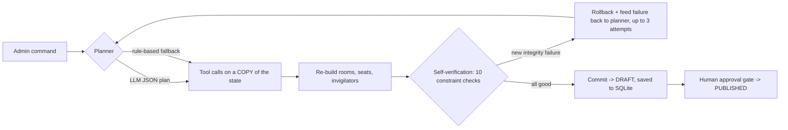

# JKLU Autonomous Exam & Seating Agent  (PS-05)

An agentic system that builds a **clash-free exam timetable**, allocates **venues and invigilators**, produces **seat-level
plans that separate students taking the same course**, accepts **natural-language changes**, explains conflicts, and
publishes **only after administrator approval**.

## Quick start
```bash
pip install -r requirements.txt
export ADMIN_PIN="choose-a-strong-pin"        # Windows PowerShell: $env:ADMIN_PIN="..."
streamlit run app.py
```
1. Sidebar -> role **Admin**, enter the PIN.
2. Tick **Quick-Load Demo Dataset** (synthetic data) -> **Generate Space-Optimized Seating**.
3. Try the chat: `Cancel Monday then auto reschedule`, `Swap physics and maths`,
   `Dr. Suresh Kumar is on leave, give his duty to Dr. Vikram Singh`, `Where does 2026BTech005 sit?`, `Verify`, `Reset`.
4. **Approve & Publish** (blocked while any integrity check fails) -> downloads (PDF / Excel) unlock.
5. Open **Access credentials** (admin only) to get faculty / student codes, then sign in as Student / Faculty.

Optional: set `GEMINI_API_KEY` / `ANTHROPIC_API_KEY` (or paste a key in the sidebar) to use the LLM planner. Without a key
the deterministic rule-based planner runs, so the demo never depends on the network.

## How the agent works

* **Planning** - multi-step commands become ordered tool calls (`cancel -> place_pending`, `leave -> reassign_duty`, ...).
* **Tools** - cancel, move, swap (courses or days), shifts, leave, reassign duty, auto-reschedule, student/faculty lookups.
* **Error recovery** - tool failures and verification failures are fed back to the planner (3 attempts), the LLM falls back to
  the rule planner, and any unexpected exception leaves the schedule untouched.
* **Timetable** - OR-Tools CP-SAT (balanced load, no back-to-back exams for students who share courses) when installed;
  every solver answer is re-verified and the greedy planner is the fallback.
* **Seating** - hill-climbing with restarts: direct neighbours (side-by-side, front/back) are eliminated first, then
  diagonal and one-seat-gap pairs are minimised. Verified and reported per room.
* **Validation** - 10 checks: complete schedule, open shifts only, every student seated exactly once, no clashes, capacity,
  unique seats, invigilators not double-booked or on leave, every room staffed, two invigilators, anti-collusion.

## Safety, privacy, governance
* **Human-in-the-loop** - publishing is a button, never a chat/LLM action; any agent change reverts the plan to DRAFT and revokes publication.
* **RBAC** - Admin PIN (env/secret, never displayed); faculty sign in with Faculty ID + code, students with roll + code
  (HMAC-derived codes, 5 wrong attempts -> 5-minute lock-out). Students/faculty only see published data about themselves.
* **Synthetic data only**; all integrations are local/mock. User-supplied text is HTML/PDF-escaped.
* **Audit log (SQLite)** - commands, plans, every tool call and output, rollbacks, approvals/revocations, logins and failures;
  survives refresh/restart and is exported in the Excel report.

## Project layout
| File | Purpose |
|---|---|
| `app.py` | Streamlit UI, access control, approval gates, agent loop |
| `engine.py` | Scheduling, seating optimiser, invigilators, validation (pure, tested) |
| `solver.py` | CP-SAT planner + independent plan verifier |
| `tools.py` / `nlu.py` / `llm.py` | Tool belt / rule-based NLU / optional LLM planner |
| `reports.py` | Floor maps, print-ready PDFs, course table |
| `storage.py` / `auth.py` | SQLite persistence + lock-outs / access codes |
| `tests/` | `python -m unittest discover -s tests` (engine, storage, auth, solver, full app flow with a fake Streamlit) |

## Configuration
| Variable | Meaning |
|---|---|
| `ADMIN_PIN` | Admin PIN (a built-in demo fallback exists; the admin sees a warning while it is active) |
| `APP_SECRET` | Secret for access codes (auto-generated and stored in the DB if unset) |
| `JKLU_DB_PATH` | SQLite file (default `jklu_exam.db`) |
| `GEMINI_API_KEY`, `ANTHROPIC_API_KEY` | Optional LLM planner |

## Known limitations
* Single-process SQLite (last write wins) - fine for a campus demo, not for many concurrent admins.
* The LLM planner is one plan per attempt (with failure feedback), not a free-running tool-use loop.
* Weekly Mon-Fri / two-shift model; no exam durations or room-type constraints.
